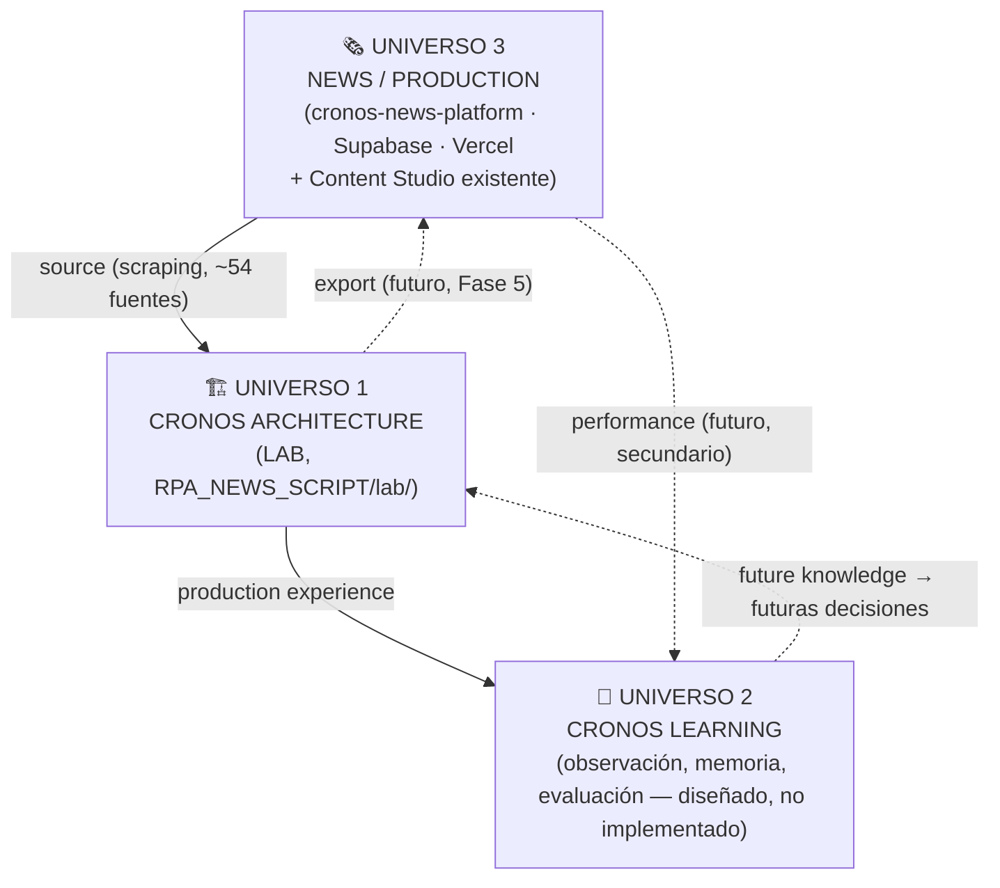

# 🌌 CRONOS — Tres Universos

Nota hub. Separa conceptualmente los tres sistemas que conforman "CRONOS" para que ninguno dependa operativamente de otro más allá de la relación mínima necesaria. Ver [[LAB - Local Editorial Lab]] para el estado real de implementación de Universo 1 (hoy: Fases 1–4.2).

## Los tres universos

Líneas sólidas = relación ya existente o de implementación inmediata. Líneas punteadas = relación futura, todavía no construida.

## Universo 1 — CRONOS Architecture

*"¿Cómo produce CRONOS contenido?"*

Vive en `RPA_NEWS_SCRIPT/lab/`, otro repo. Pipeline: Ingestión → Editorial Intelligence → Media Intelligence → **Narrative/Audio Direction (diseñado)** → Sequence → Animation → Render → **Assembly (pausado, en diseño)**. Ver [[LAB - Local Editorial Lab]] (estado real) y [[CRONOS - Narrative & Audio Direction]] (capa nueva en diseño).

## Universo 2 — CRONOS Learning

*"¿Cómo aprende CRONOS de lo que produjo?"*

Observa Architecture desde afuera — nunca al revés. **Architecture debe poder producir contenido con Learning completamente apagado.** Ver [[CRONOS Learning]].

## Universo 3 — News / Production

*"¿Dónde vive y se publica el contenido?"*

Este mismo repo (`cronos-news-platform`, Next.js + Supabase + Vercel), incluyendo el Content Studio ya existente (`src/studio/`, ver [[Feature - Social Media Studio v2]]) — un editor de video **separado** de LAB, no reemplazado por él. Ver [[Home]], [[Master (producción)]], [[Supabase]].

## Regla de dependencia (para Graph View)

> [!important] Regla
> **Learning puede referenciar Architecture. Architecture no depende conceptualmente de Learning.**
> En código: `lab/learning/` (futuro) puede importar/leer artifacts de `lab/sequence/`, `lab/animation/`, etc. — nunca al revés. Ningún módulo de Architecture importa nada de Learning.

Evitar deliberadamente que todas las notas del vault se enlacen entre sí — cada universo enlaza solo a sus vecinos directos en el diagrama de arriba, no a todo lo demás.

## CURRENT / DESIGNED / FUTURE

| | Universo 1 (Architecture) | Universo 2 (Learning) | Universo 3 (Production) |
|---|---|---|---|
| **CURRENT** | Fases 1–4.2 implementadas y testeadas (135+ tests) | No existe | Sitio en producción, Content Studio en desarrollo |
| **DESIGNED** | Narrative/Audio Direction, Assembly (este documento y [[CRONOS - Narrative & Audio Direction]]) | Arquitectura conceptual completa ([[CRONOS Learning]]) | — |
| **FUTURE** | Fase 5 (export a Production), AI_VIDEO real | Experience Data, Feedback, Evaluation, Memory/Retrieval, modelos especializados | Señal de performance hacia Learning |
