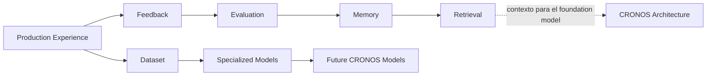

# 🧠 CRONOS Learning

*"¿Cómo aprende CRONOS de lo que produjo?"* — distinto de [[LAB - Local Editorial Lab]] (Architecture: *"¿cómo produce CRONOS contenido?"*). Ver [[CRONOS - Tres Universos]] para cómo encajan los dos.

> [!important] Regla de aislamiento
> Learning **observa** Architecture desde afuera (lee sus artifacts JSON ya escritos) y nunca corre sincrónicamente dentro de ningún comando de `lab.cli`. Architecture debe poder producir una historia completa con Learning apagado o inexistente — cero imports desde `lab/sequence`, `lab/animation`, `lab/render`, `lab/assembly` (futuro) hacia código de Learning, y ninguno en la dirección contraria tampoco (Learning importa nada de esos paquetes — solo lee sus archivos de salida, igual que Animation lee `sequence.json`: por archivo, no por import de código).

## El pipeline conceptual



## Los términos, sin mezclar (pedido explícito: distinguirlos)

| Término | Qué es | Qué NO es |
|---|---|---|
| **Historial** | Registro crudo de jobs ya corridos (`lab/jobs/done\|failed/`, ya existe hoy) | No es aprendizaje — es log operativo |
| **Production Experience** | Snapshot de una historia terminada: todos sus artifacts (editorial, media, narrative, audio, sequence, animation, render, assembly, final_reel) + la secuencia de jobs que la produjo | No incluye juicio de valor todavía |
| **Feedback** | Veredicto humano explícito en un punto de revisión (aprobar/rechazar/revisar + motivo) — hoy la revisión humana ocurre *fuera* de LAB, sin capturarse | No es evaluación automática |
| **Evaluación** | Puntaje/juicio (humano o de un futuro LLM-judge) sobre si una decisión declarada (ej. el arco emocional de Narrative Direction) se cumplió en el resultado final | No es memoria — es una medición puntual |
| **Memoria** | Conocimiento **destilado** de muchas Production Experience + Feedback + Evaluation — curado, no el dump crudo | No es el dataset — es lo que se extrae de él |
| **Retrieval** | Traer memoria/experiencias pasadas relevantes como contexto para una decisión *nueva* (ej. "la última vez que tuvimos un arco TRAGEDIA→ESPERANZA en deportes...") | No reemplaza el razonamiento del foundation model — lo informa |
| **Dataset** | Corpus acumulado y versionado de tuplas (contexto, decisión, resultado) | No es memoria (memoria es curada, dataset es crudo) |
| **Fine-tuning / Entrenamiento** | Ajustar o entrenar un modelo con el Dataset una vez que hay volumen y Evaluation que lo justifique | Etapa final, no el punto de partida |

## Modelo de Experience Data

Una `ProductionExperience` por historia terminada: `story_id`, timestamp, referencias a **todas** las versiones de artifacts involucradas (no copias — solo el path/id), y los jobs reales que ya quedan en `lab/jobs/`. Se captura **después** de que una historia llega a un estado terminal (aprobada/rechazada/exportada) — nunca a mitad de pipeline.

## Modelo de Feedback

Hoy no existe ningún mecanismo que capture la revisión humana (es manual, fuera de LAB — confirmado en la documentación de cada skill: "revisión humana, manual, fuera de LAB"). El primer paso real de Learning (futuro, no ahora) sería formalizar *solo la captura* de ese veredicto — sin cambiar cómo se revisa hoy.

## Modelo de Evaluación

Empieza barato: el Feedback humano *es* la evaluación inicial (cero infraestructura nueva). Más adelante, un LLM-judge puede comparar intención declarada (ej. `narrative_direction.json`) contra el resultado real (`final_reel.mp4`) — requiere un evaluador multimodal, no existe todavía.

## Memory / Retrieval

Memoria = destilado curado de muchos registros (no el dump crudo). Retrieval = traer experiencias pasadas relevantes como **contexto** para el foundation model en una decisión nueva — nunca como regla dura. Implementación futura: embeddings sobre `ProductionExperience` + un vector store.

## Estrategia evolutiva de modelos

```
FOUNDATION MODEL (hoy: Claude, vía skills de Claude Code — así funciona todo Fase 1–4.2 ya)
  + CRONOS MEMORY
  + CRONOS EXPERIENCE DATA
  + CRONOS EVALUATION
  + SPECIALIZED MODELS (más adelante: modelos chicos/baratos para UNA decisión repetible ya bien etiquetada)
  + FUTURE CRONOS MODELS (visión final: un modelo con voz narrativa propia, entrenado sobre decisiones ya aprobadas por humanos — no un modelo genérico)
```

**Ahora**: 100% razonamiento del foundation model (Claude), cero modelos especializados, cero entrenamiento — es literalmente como ya funciona todo LAB hoy. **Recomendación de foundation model**: seguir con la familia Claude ya en uso en todo el proyecto (vía Claude Code) — no hay razón para introducir un segundo proveedor. **Etapa futura**: modelos especializados/afinados solo cuando exista volumen de Dataset + Evaluation que lo justifique económicamente — nunca entrenar desde cero prematuramente.

## CURRENT / DESIGNED / FUTURE

- **CURRENT**: no existe ningún código de Learning. Solo existe el historial de jobs (`lab/jobs/`), que ya es un insumo crudo reutilizable el día que esto se construya.
- **DESIGNED**: este documento — el pipeline conceptual completo y la separación de términos.
- **FUTURE**: todo lo demás — captura de Feedback, Evaluation, Memory/Retrieval, Dataset, modelos especializados.
